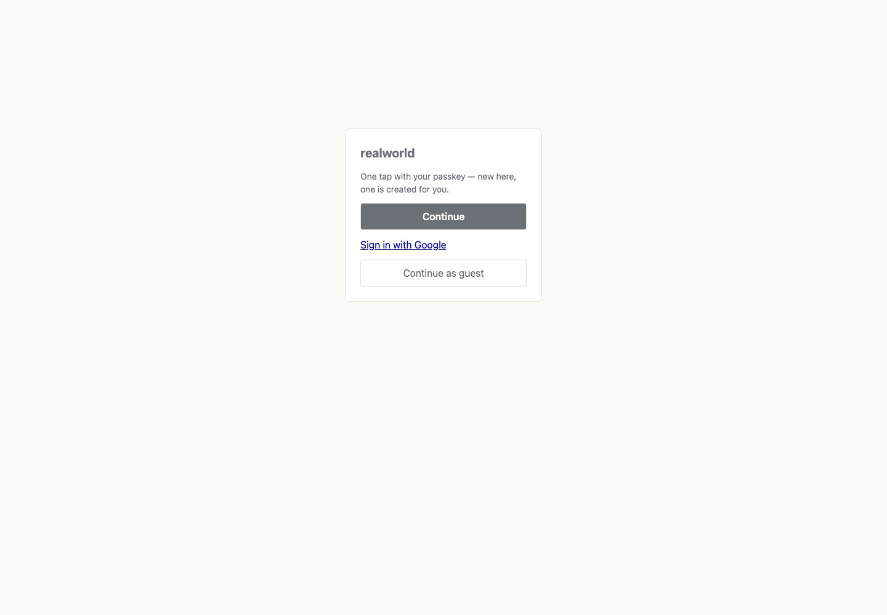
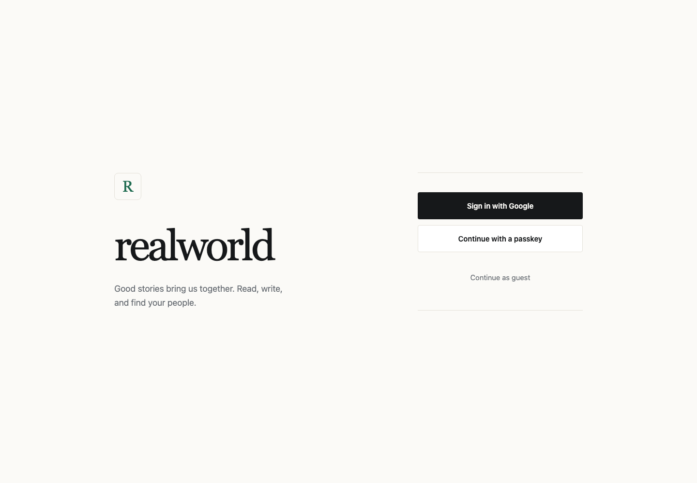
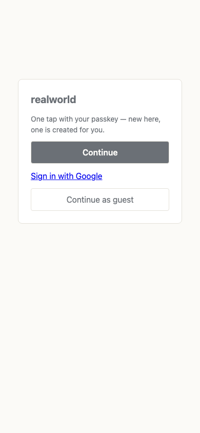
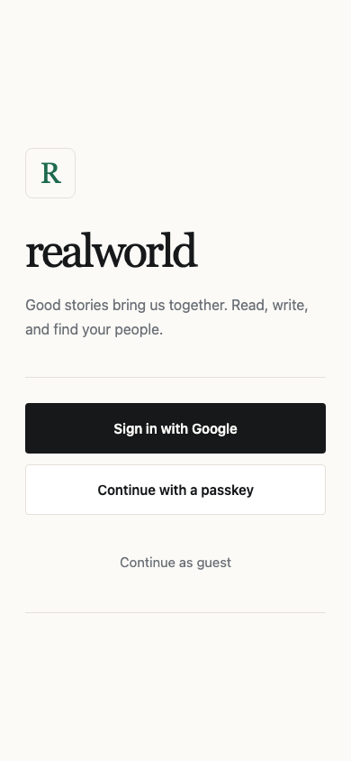
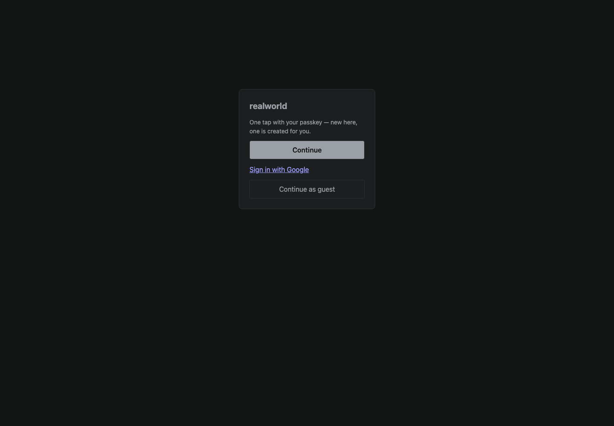
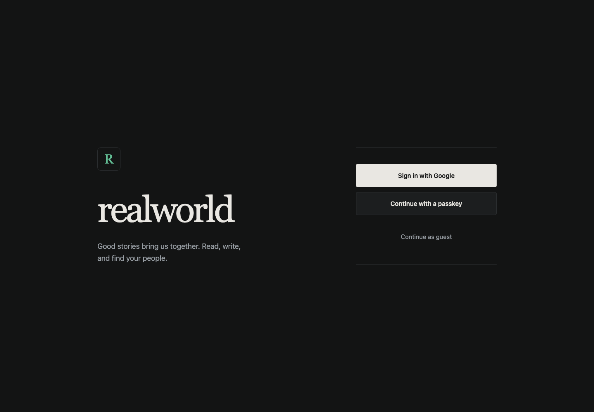

# Login design journal

Status: implemented. The live contract is in [[../DESIGN.md|Press]] and [[../ir.html|the application design]].

## Evidence and decision

The previous terminal gate centered a small generic card in a large empty page. Its Google action was an unstyled browser link, and “Continue” did not distinguish the passkey ceremony. The accepted Press identity already supplied the direction: warm paper, ink, pine, editorial type and quiet rules. No separate visual identity was introduced.

The shared terminal now separates the app introduction from the action panel. A large serif masthead and app-initial monogram provide identity; Google has the strongest full-width control, passkey is outlined and explicitly named, and guest access remains visible but quiet. The single-column mobile version preserves that order. Dark mode resolves the same tokens. The monogram is decorative, the form is named by its heading, errors are announced, and controls receive visible keyboard focus. No authentication behavior changed.

## Before and after

Captured from the actual running `https://localhost:17995/` login in fresh Chromium contexts: desktop 1440×1000, mobile 390×844, and desktop dark appearance. The browser audit found no horizontal overflow; every action was 56px high. The same capture script was used for both states.

| View | Before | After |
| --- | --- | --- |
| Desktop |  |  |
| Mobile |  |  |
| Dark |  |  |

## Checks

The nine login smoke tests pass, including provider return URLs, guest entry, session adoption, sign-out, localization and inline failure handling. Navigation's forty existing checks passed with the new markup. RealWorld's generation, lint and test gates passed after the design change. Screenshot inspection confirmed the hierarchy, typography, mobile fit and dark appearance. Real Google authentication still requires the credentials described in [[google-sign-in]]; these screenshots establish the login surface, not a provider callback.

## Theme and provider-free regression check

The browser audit also substituted freshly generated eSocial CSS into isolated login contexts and removed the provider link to exercise the required passkey/guest-only gate. A synthetic palette kept the outer background dark while the content surface stayed white. Both fixtures passed at desktop and mobile sizes in light and dark appearance: eight contexts total. Fixture-injection transitions were disabled before measurement; no application data or provider configuration was changed.

Minimum text contrast was 5.48:1 for eSocial light, 6.36:1 for eSocial dark, and 7.58:1 for the synthetic palette. Every action remained 56px high, with no horizontal overflow or action overlap and visible keyboard focus. This verifies that the login uses the content surface rather than inheriting an incompatible outer background, and that passkey remains the primary action when no provider is configured.
